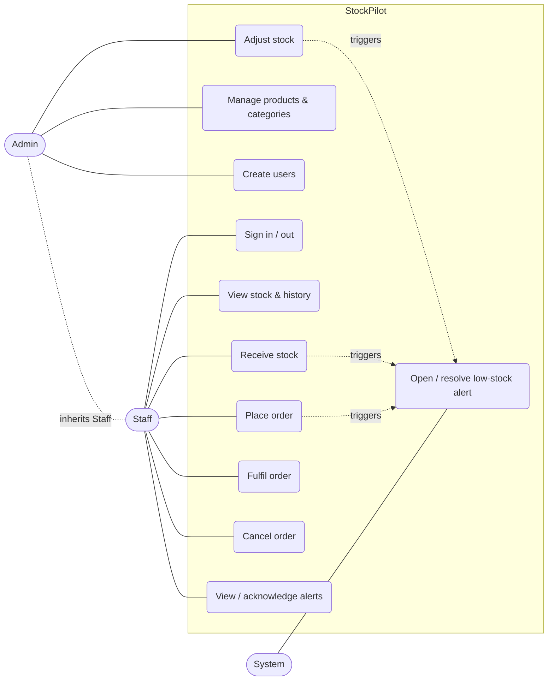

# 1. Requirements

StockPilot tracks stock for one warehouse: what is on the shelf, what is promised to orders, and what can still be sold. It raises an alert when a product runs low.

## Actors

| Actor | Who | Can do |
|---|---|---|
| **Staff** | Warehouse / counter worker | Sign in, view stock and history, receive deliveries, place / fulfil / cancel orders, view and acknowledge alerts |
| **Admin** | Manager | Everything Staff can, plus: manage products and categories, adjust stock (corrections), create users |
| **System** | The EventBus listener and housekeeping timer | Open/resolve low-stock alerts after stock changes; delete expired sessions |

## Functional requirements

| ID | Requirement |
|---|---|
| F1 | Users sign in with email and password; sessions last 8 hours and roll forward while in use. Sign-out ends the session on the server. |
| F2 | The first Admin is created from `ADMIN_EMAIL` / `ADMIN_PASSWORD` on first start. Admins create further users (`POST /api/users`). |
| F3 | Admins create, edit (with optimistic locking) and deactivate products; each has a unique SKU, a price in cents, an optional category and a reorder rule. |
| F4 | Reorder rule is either a fixed quantity or a percentage of a "full shelf" quantity. |
| F5 | Everyone sees stock per product: on hand, reserved, available (= on hand − reserved), and whether it is low. Lists are searchable and paginated. |
| F6 | Staff record receipts (stock in). Admins record adjustments (signed, with a reason). |
| F7 | Every stock change is written to an append-only ledger; the full history per product is viewable. |
| F8 | Placing an order reserves stock for every line atomically. If any line is short, nothing is reserved and the user is told which line and how many are available. |
| F9 | A reserved order can be fulfilled (stock leaves the shelf, SALE ledger entries) or cancelled (reservation released). Nothing else can happen to it afterwards. |
| F10 | When available stock reaches a product's threshold, one alert opens. It resolves automatically when stock rises above the threshold. Users can acknowledge ("mark as seen"). |

## Non-functional requirements

| ID | Requirement | How it is met |
|---|---|---|
| N1 | **No overselling** under concurrent requests | Row locks (`SELECT … FOR UPDATE`) in sorted order + domain check + DB `CHECK` constraints. Proven by the 50-parallel-orders test. |
| N2 | **Auditability** | Append-only `stock_movements` (DB trigger); ledger sum equals on-hand. |
| N3 | **Consistent errors** | One error shape `{ error: { code, message, details?, requestId } }`; one mapping table. |
| N4 | **Security** | argon2id passwords, hashed session tokens, httpOnly/SameSite/`__Host-` cookies, CSRF Origin check, CSP + security headers, login rate limit, body-size limit, role checks on the server. |
| N5 | **Fail fast** | Config validated with zod at startup. |
| N6 | **Operability** | Structured JSON logs with request IDs, `/api/health`, graceful shutdown, migrations on start. |
| N7 | **Performance**: p95 < 200 ms on seed data | Indexed reads, paginated lists (max 100). Measured locally (10 concurrent clients, seed data, M-series Mac): reads p50 8 ms / p95 15 ms; receipts p50 22 ms / p95 43 ms. Login takes about 100 ms on purpose (argon2id). |

## Use cases

### Main use case: UC5 Place order
- **Actor:** Staff (or Admin). **Precondition:** signed in.
- **Main flow:** choose products and quantities → system locks the stock rows, reserves each line, saves the order as RESERVED → returns the order.
- **Alternative flows:** a line is short → 409 `INSUFFICIENT_STOCK` with `{productId, requested, available}`, nothing saved. Product unknown/inactive → 404. Invalid input → 400 with field errors.
- **Postcondition:** reserved quantities increased; low-stock alert opened if a product dropped to its threshold.

### Out of scope (deliberately)
Multiple warehouses, transfers, suppliers/purchase orders, user-management screens, password reset, idempotency keys.
