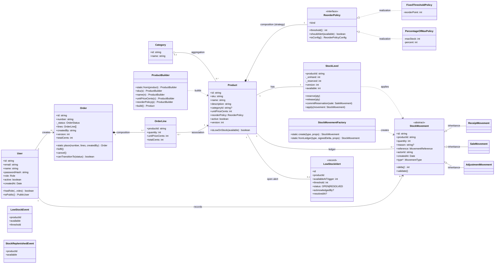
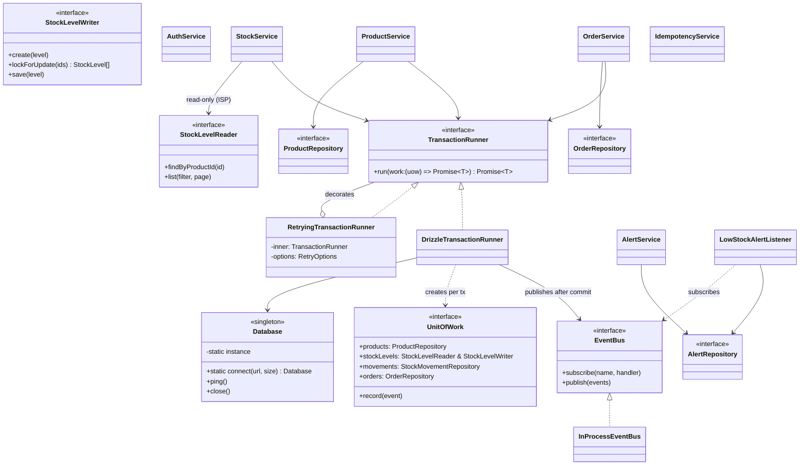

# 2. Class diagram

Domain classes live in `server/src/domain`, application services and ports in `server/src/application`, adapters in `server/src/infrastructure`.

## Domain model

### Relationship notes

| Relationship | Kind | Why |
|---|---|---|
| StockMovement → Receipt / Sale / Adjustment | **Inheritance** | Shared fields and `validate()`; each subclass defines its own `delta()` and extra rules. |
| ReorderPolicy → Fixed / PercentageOfMax | **Interface realization** | Interchangeable strategies. |
| Order ◆— OrderLine (1..\*) | **Composition** | Lines have no life outside their order; saved and deleted with it (`ON DELETE CASCADE`). |
| Product ◆— ReorderPolicy (1) | **Composition** | The policy object belongs to exactly one product. |
| Category ◇— Product (0..\*) | **Aggregation** | A category groups products; deleting it leaves the products (`ON DELETE SET NULL`). |
| OrderLine → Product (1) | **Association** | A line references a product; the product exists independently (`ON DELETE RESTRICT`). |
| User → Order (0..\*) | **Association** | `orders.created_by`. |
| Product — StockLevel (1..1) | **Association, one-to-one** | Shared primary key `stock_levels.product_id`. Created in the same transaction as the product. |

## Application layer

The HTTP layer (`server/src/http/routes/*`) depends on services only; `container.ts` is the only place that creates concrete classes.
