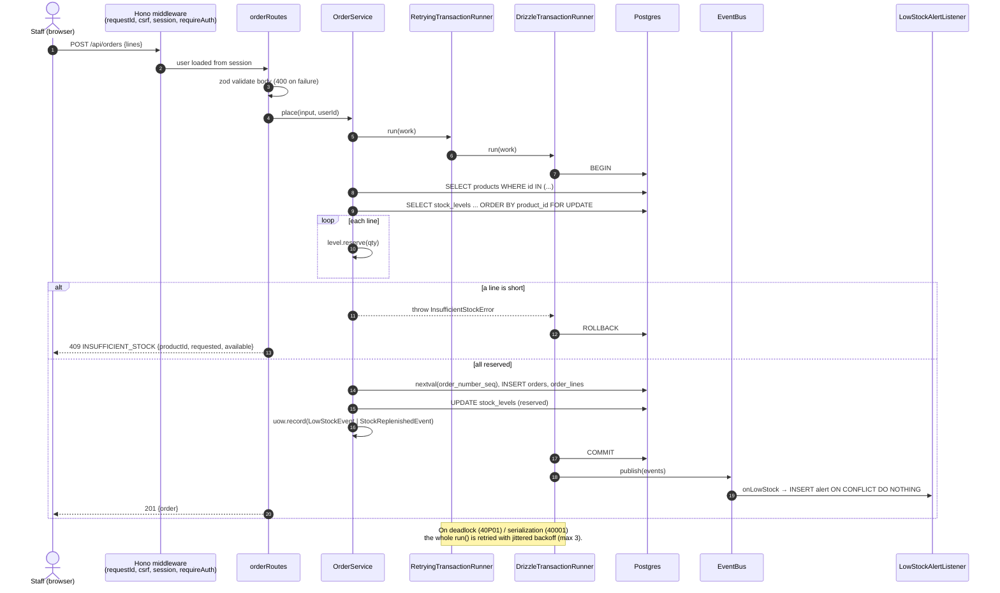
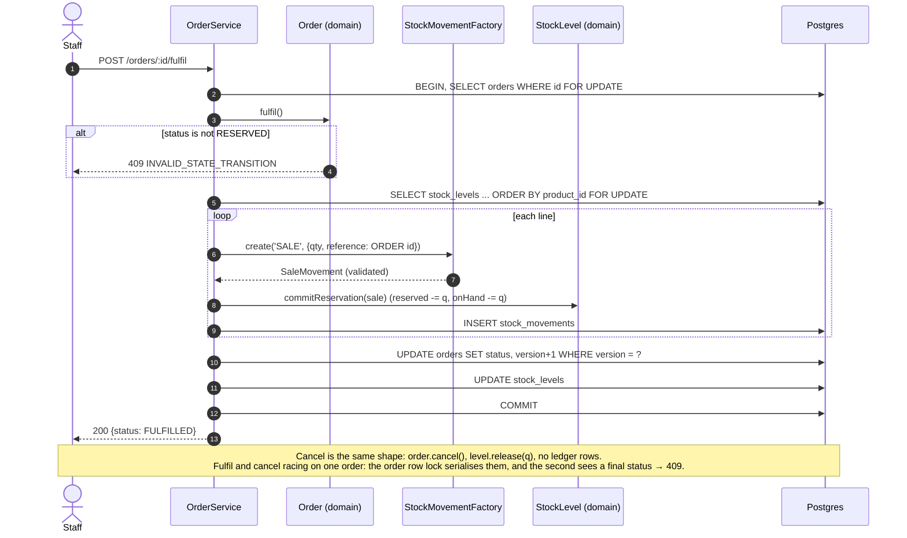
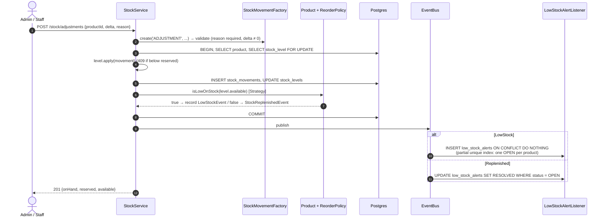
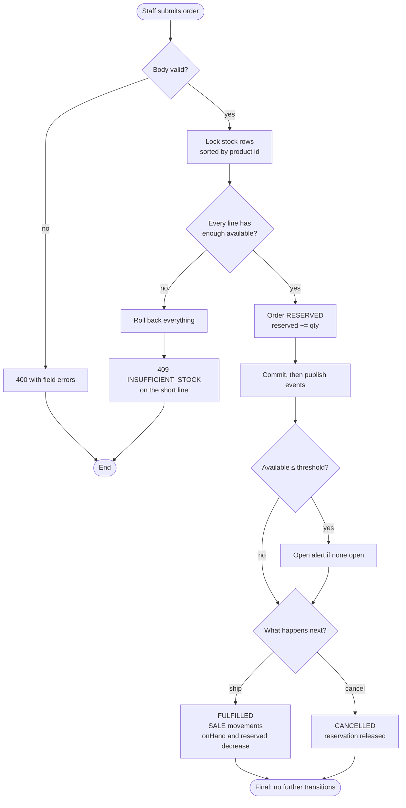
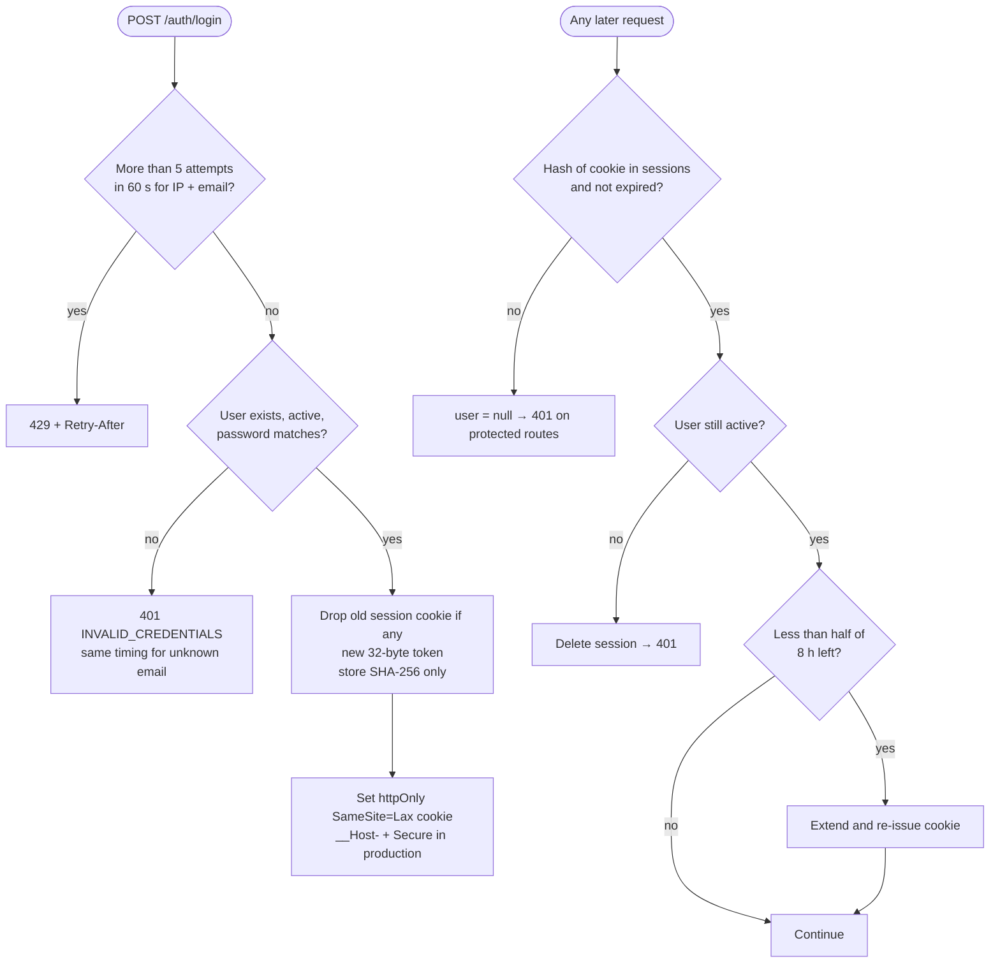

# 5. Sequence and activity diagrams

## 5.1 Place an order (reserve stock)

## 5.2 Fulfil or cancel an order

## 5.3 Receive / adjust stock and the alert reaction

## 5.4 Activity: order lifecycle

## 5.5 Activity: sign-in and session check

