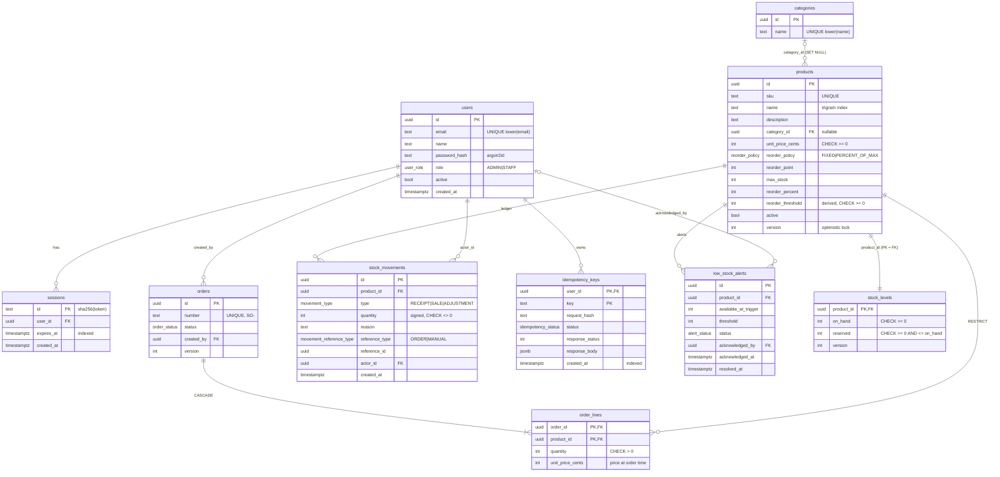

# 7. Database schema

PostgreSQL 16. Tables are defined in `server/src/infrastructure/db/schema.ts` (Drizzle). Migrations: `server/drizzle/0000_init.sql` (generated) and `server/drizzle/0001_ledger_and_search.sql` (hand-written: append-only trigger, trigram index). They are applied on every start; already-applied migrations are skipped.

## ER diagram

## Class → table mapping

| Class | Table | Notes |
|---|---|---|
| `User` | `users` | `toPublic()` removes `password_hash` from responses. |
| session (`Session` record) | `sessions` | The id is the token hash, so a stolen table cannot be replayed as cookies. |
| `Category` | `categories` | |
| `Product` + `ReorderPolicy` | `products` | Strategy flattened into `reorder_policy` + params; a CHECK enforces the right params per kind. `reorder_threshold` = `policy.threshold()`, stored so "low only" is a plain SQL filter. |
| `StockLevel` | `stock_levels` | One row per product (shared PK). |
| `StockMovement` hierarchy | `stock_movements` | Single-table inheritance: `type` column chooses the subclass via `StockMovementFactory.fromLedger`. `quantity` stores `delta()`, so `SUM(quantity) = on_hand`. |
| `Order` / `OrderLine` | `orders` / `order_lines` | Composition maps to `ON DELETE CASCADE`; composite PK `(order_id, product_id)` also enforces "one line per product". |
| `LowStockAlert` | `low_stock_alerts` | |
| `IdempotencyRecord` | `idempotency_keys` | |

## Keys, constraints and why

| Rule | Enforced by |
|---|---|
| SKU unique | `products_sku_uq` |
| Email / category name unique regardless of case | unique index on `lower(...)` |
| Stock can never go negative or reserve more than is on hand | `stock_on_hand_nonneg`, `stock_reserved_nonneg`, `stock_reserved_le_on_hand` |
| Ledger rows are never edited or deleted | trigger `stock_movements_append_only` (BEFORE UPDATE OR DELETE) |
| At most one OPEN alert per product, even with concurrent listeners | partial unique index `alerts_one_open_per_product_uq ON (product_id) WHERE status='OPEN'` |
| A product with history cannot be hard-deleted | `ON DELETE RESTRICT` from `stock_levels`, `stock_movements`, `order_lines` (products are soft-deleted via `active`) |
| An idempotency key is per user | PK `(user_id, key)` |
| Order numbers are unique and gap-tolerant | sequence `order_number_seq` + `orders_number_uq` |

## Indexes and the query each one serves

| Index | Query |
|---|---|
| `products_sku_uq` | SKU lookup / uniqueness |
| `products_name_trgm_idx` (GIN, pg_trgm on `lower(name)`) | `GET /products?q=` and `/stock?q=` use `LIKE '%term%'`, which a btree cannot serve |
| `products_category_idx` | filter by category; FK checks on category delete |
| `movements_product_created_idx (product_id, created_at DESC)` | history page per product, newest first |
| `movements_reference_idx (reference_type, reference_id)` | "which movements belong to order X" |
| `orders_status_created_idx (status, created_at)` | orders list filtered by status |
| `order_lines_product_idx` | FK checks; "orders containing product" |
| `alerts_status_created_idx` | alerts list by status |
| `sessions_expires_at_idx` | housekeeping `DELETE … WHERE expires_at <= now()` |
| `idempotency_created_idx` | housekeeping of keys older than 24 h |

## Concurrency model
- Isolation: READ COMMITTED (the Postgres default) with explicit row locks.
- Stock-changing transactions `SELECT … FOR UPDATE` the affected `stock_levels` rows **ordered by product_id**, so overlapping transactions take locks in the same order and cannot deadlock each other. If Postgres still reports a deadlock or serialization failure, `RetryingTransactionRunner` retries.
- Product edits use optimistic locking (`UPDATE … WHERE version = ?`) because humans editing forms hold no locks.
- Order status changes lock the order row, then also check `version`.
